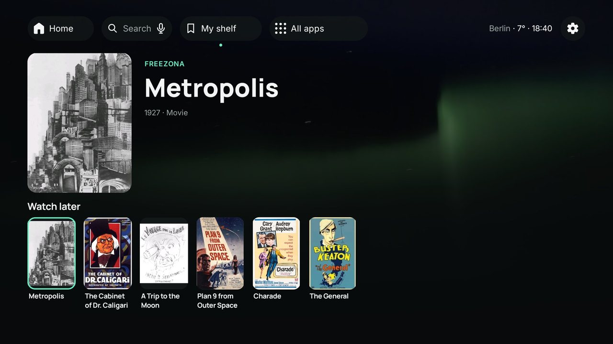
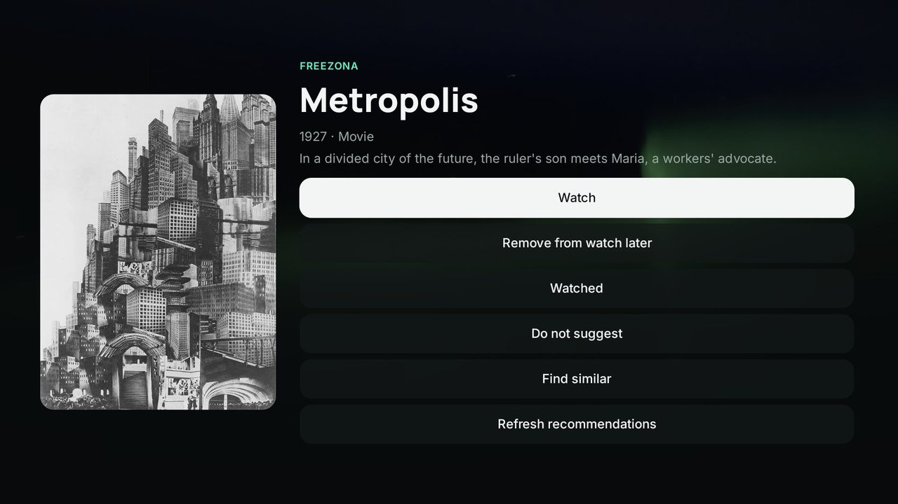
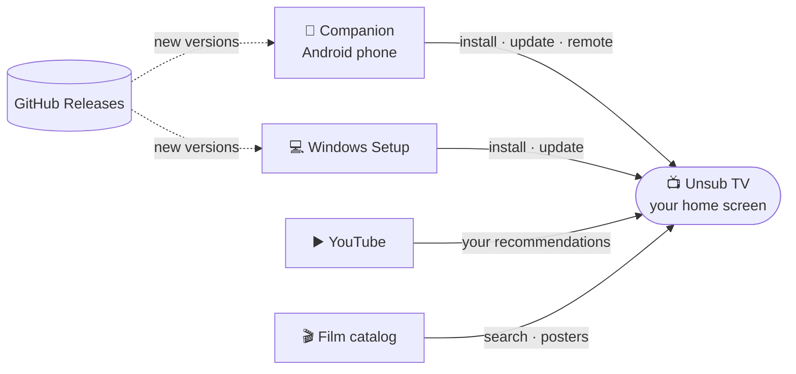

<a href="#readme">
  <picture>
    <source media="(prefers-color-scheme: dark)" srcset=".github/readme/hero-en-dark.svg">
    <source media="(prefers-color-scheme: light)" srcset=".github/readme/hero-en-light.svg">
    
  </picture>
</a>

[Русский](README.md) · **English**

  

&nbsp;
&nbsp;

Public beta · the phone or PC and the TV must be on the same home network

 

[**Why**](#why) &nbsp;·&nbsp; [**Features**](#features) &nbsp;·&nbsp; [**Install**](#install) &nbsp;·&nbsp; [**Remote**](#remote) &nbsp;·&nbsp; [**How it works**](#how-it-works) &nbsp;·&nbsp; [**FAQ**](#faq) &nbsp;·&nbsp; [**Privacy**](#privacy)

 

## Why

You pay for five to seven services, then spend the evening jumping between five to seven apps looking for one film. After work you just want to sit down and press play.

**Unsub TV is one home screen for all of it.** YouTube recommendations, films, your apps and your own lists live on one screen you can drive with a plain remote. No Unsub account, no ads, no subscription. It is free and stays free; the project lives on donations only.

## Features

<table>
  <tr>
    <td width="33%" valign="top">
      
      <h3>🏠 One home screen</h3>
      Recommendations from YouTube and films next to your favorite apps. Focus glows, so you see it from the couch.
    </td>
    <td width="33%" valign="top">
      
      <h3>🎙️ Just say it</h3>
      Press the mic on the remote and say a title, or describe a mood: <i>“classic sci-fi”</i>, <i>“a comedy for tonight”</i>.
    </td>
    <td width="33%" valign="top">
      
      <h3>🔖 My shelf</h3>
      Watch later, continue watching, watched and “don’t suggest”. Everything stays on the TV.
    </td>
  </tr>
  <tr>
    <td width="33%" valign="top">
      
      <h3>⚡ One click actions</h3>
      Watch, save for later, mark as watched, hide, find similar. Hold <kbd>OK</kbd> on any card.
    </td>
    <td width="33%" valign="top">
      
      <h3>📱 Phone as a remote</h3>
      The Companion installs and updates the TV app, types searches for you and opens your lists.
    </td>
    <td width="33%" valign="top">
      
      <h3>🛠️ Yours to tune</h3>
      Home screen, search, screen and sound, remote and sleep timer. English and Russian out of the box.
    </td>
  </tr>
</table>

<b>Everything else it does</b>

 

- **Search by description.** Add your own Groq key and ask for “space sci-fi from the 70s”. Search by title works without it.
- **Type from your phone.** Scan the QR on the TV and send text from the phone instead of typing with arrows.
- **Updates keep your stuff.** A new version installs over the old one; settings, lists and keys stay.
- **Easy way back.** One switch in settings returns the stock home screen of your TV.
- **Light on old boxes.** Static background, limited downloads and no focus zoom when RAM is low.
- **Works on its own.** After setup the TV needs neither the phone nor an always-on PC.

## Install

> [!TIP]
> Connect the phone or PC and the TV to **the same home router** first. Then pick one of the ways below.

<b>📱 Android phone</b> &nbsp;recommended

 

1. Download **`UnsubTV-Companion-*.apk`** from [Releases](https://github.com/Startupingarage/unsub-tv-releases/releases) and install it on the phone.
2. Open it and choose **Set up a new TV**.
3. Follow the pairing steps on the phone and confirm the requests on the TV.

<b>💻 Windows PC</b>

 

1. Download **`UnsubTV-Setup-*.zip`** from [Releases](https://github.com/Startupingarage/unsub-tv-releases/releases) and extract it.
2. Run the setup app and choose **New installation**.
3. Follow the instructions on the PC and the TV.

<b>🔄 Update</b>

 

Grab the latest Companion or Windows Setup from [Releases](https://github.com/Startupingarage/unsub-tv-releases/releases) and choose **Update Unsub TV**. The new version installs over the old one; settings and lists stay.

<b>📦 Manual TV APK</b>

 

**`UnsubTV-*.apk`** is the bare TV app for manual updates. Do the first setup with the Companion or Windows Setup: they also handle permissions and the home screen.

**Requirements:** Android TV or Google TV with Android 8.0+ (API 26). The Companion needs Android 8.0+ too.

## Remote

| Press | What happens |
| :-- | :-- |
| <kbd>🎤</kbd> | Voice search from anywhere |
| <kbd>OK</kbd> | Open the card |
| <kbd>OK</kbd> *hold* | More actions: later, watched, hide, similar |
| <kbd>▼</kbd> | Scroll down to continue watching and watch later |
| <kbd>Home</kbd> | Back to Unsub TV |

## How it works

## FAQ

<b>Is it really free?</b>

 
Yes. No subscription, no ads, no paid tier. The project lives on donations only.

<b>Will I lose my stock TV home screen?</b>

 
No. <b>Settings → Home screen → Home screen → Factory</b> brings it back. To return, open Unsub TV from the app list and switch it back. Apps and accounts stay where they are.

<b>Does the TV need my phone or PC to stay on?</b>

 
No. They are needed for setup and updates. After that the TV works on its own.

<b>Do I need a Groq key?</b>

 
No. Search by title and voice work without it. The key only enables search by description, and you can add it later during an update.

<b>Which devices are supported?</b>

 
Android TV and Google TV boxes and TVs with Android 8.0 or later. The main test device is a Xiaomi TV Box S (3rd gen) with Android 14.

## Roadmap

- [x] English and Russian in the TV app, Android Companion and Windows Setup
- [x] Install and update from a phone or a PC
- [x] Voice search and search by description
- [x] My shelf: watch later, continue, watched, don’t suggest
- [ ] New home screen with a big hero card (next beta)
- [ ] Stable 1.2.0

## Privacy

Unsub TV keeps settings, lists, recently opened titles and cached recommendations on the TV. If you add a Groq key, the app encrypts it with Android Keystore and sends the request text to Groq only when you use search by description. Voice input uses the TV’s system speech recognizer.

## Support

Unsub TV is free and always will be. If it saved you a subscription or two, ⭐ star the repo and tell a friend.

## License and credits

Unsub TV is proprietary. All rights reserved. Third-party components keep their own licenses.

Screenshots use demonstration data. Nature and space photographs from Wikimedia Commons: Kevin M. Gill, Jakub Hałun (CC BY 4.0); Michal Klajban, Giles Laurent, Gerda Arendt (CC BY-SA 4.0); Sonse (CC BY 2.0); NASA (public domain). The showcase film posters are in the public domain.

 

 
Made for evenings on the couch · <a href="#readme">back to top ↑</a>

