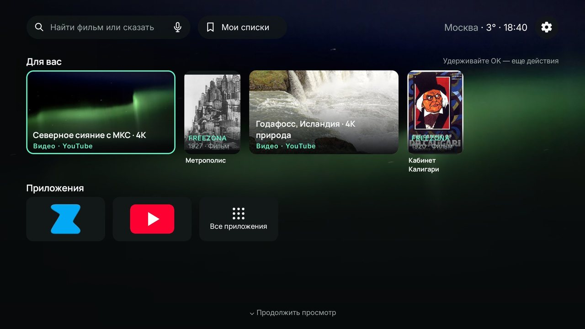
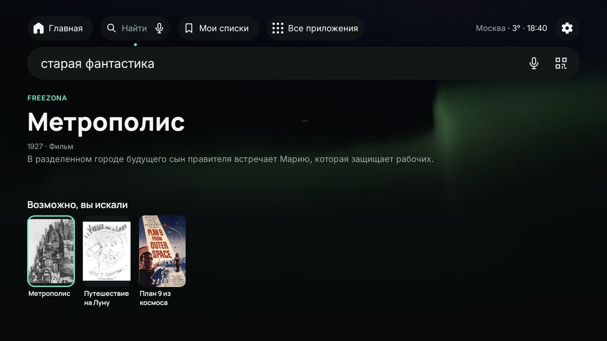
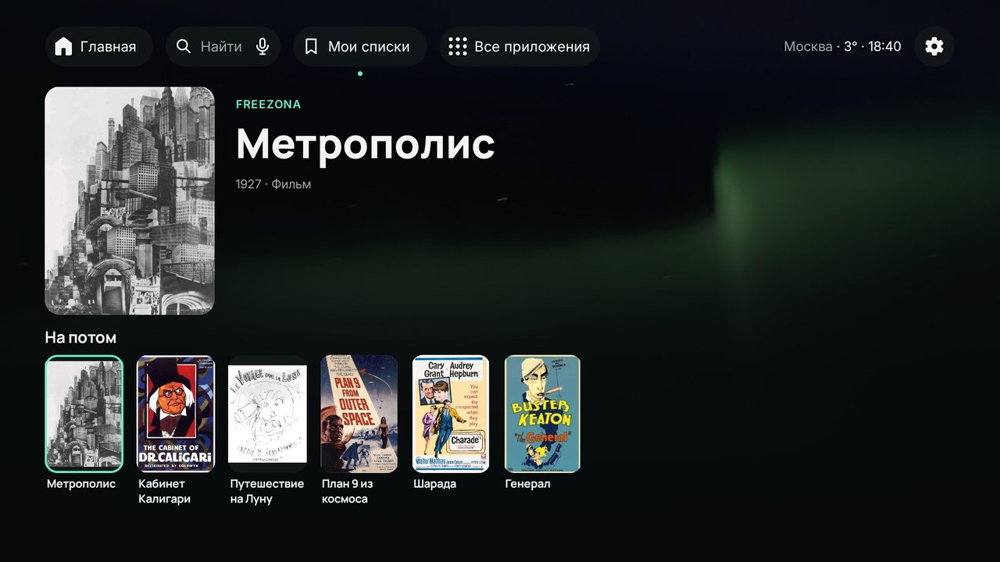
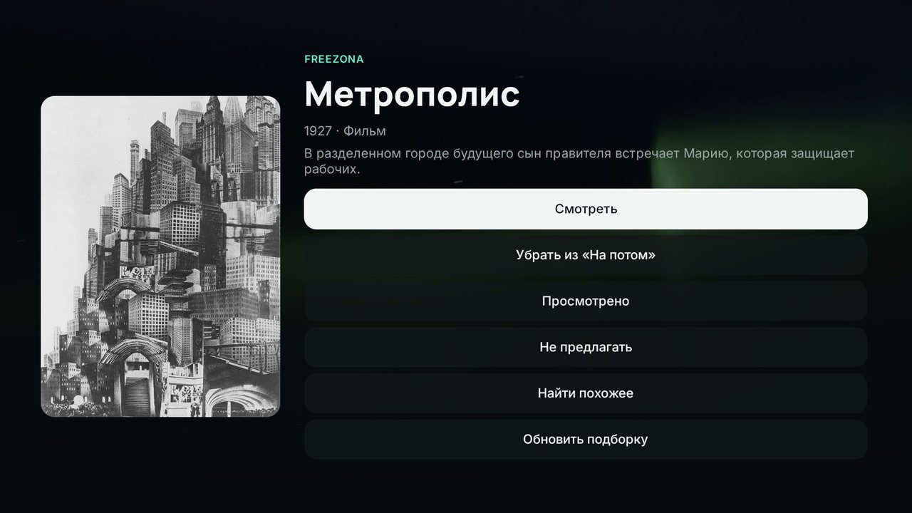
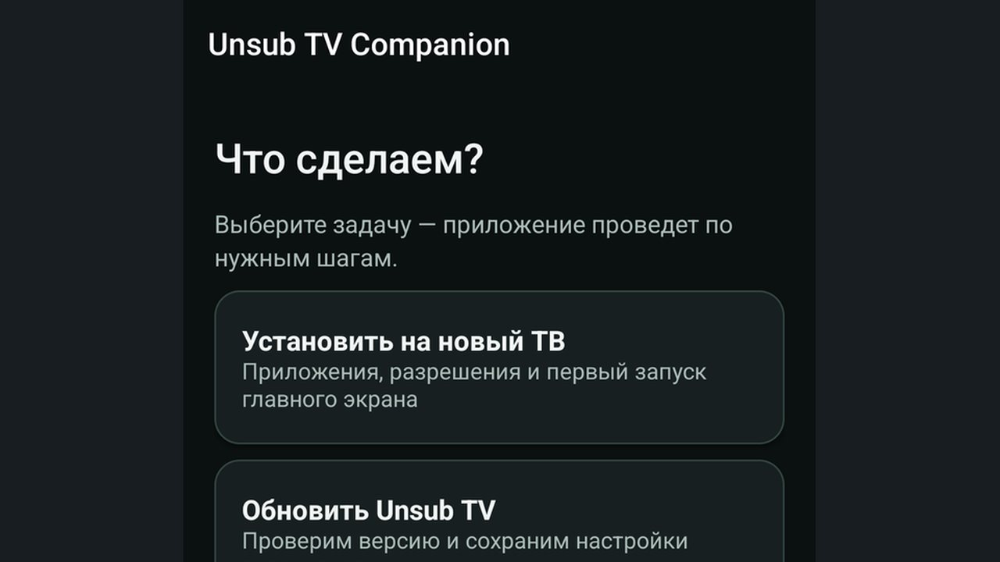
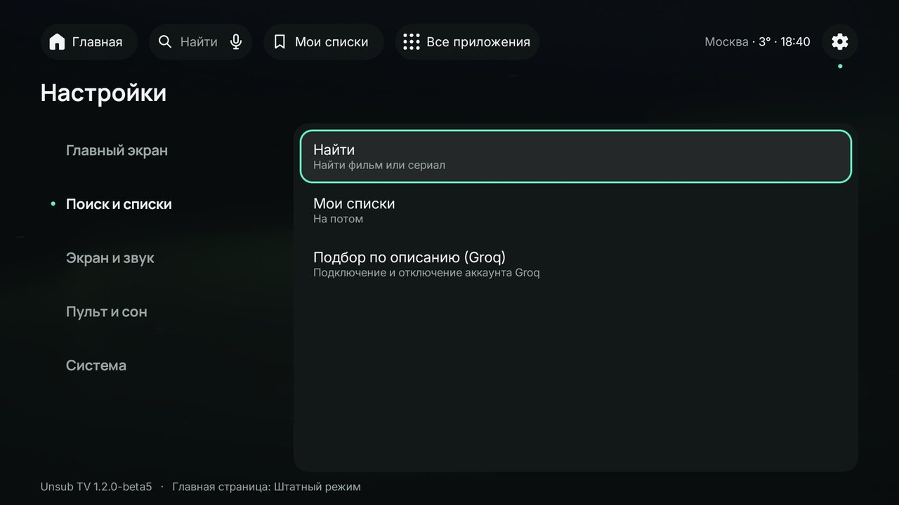
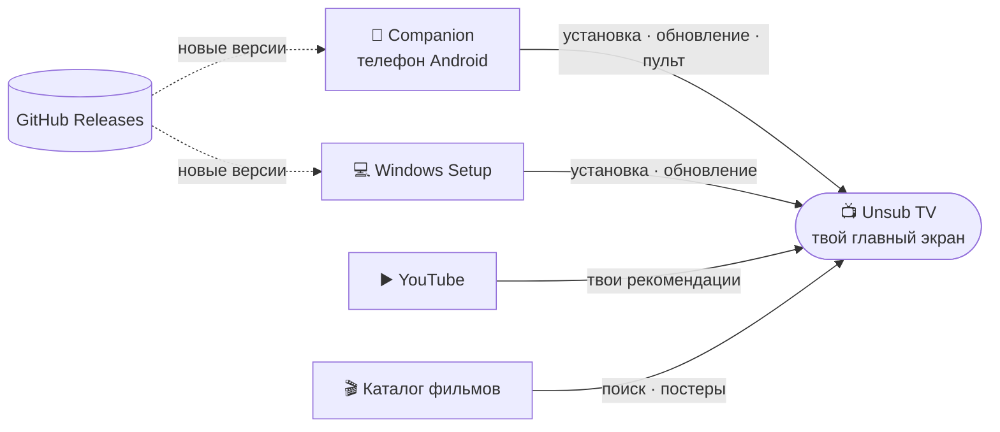

<a href="#readme">
  <picture>
    <source media="(prefers-color-scheme: dark)" srcset=".github/readme/hero-ru-dark.svg">
    <source media="(prefers-color-scheme: light)" srcset=".github/readme/hero-ru-light.svg">
    
  </picture>
</a>

**Русский** · [English](README.en.md)

  

&nbsp;
&nbsp;

Открытая бета · телефон или ПК и телевизор должны быть в одной домашней сети

 

[**Зачем**](#зачем) &nbsp;·&nbsp; [**Возможности**](#возможности) &nbsp;·&nbsp; [**Установка**](#установка) &nbsp;·&nbsp; [**Пульт**](#пульт) &nbsp;·&nbsp; [**Как устроено**](#как-устроено) &nbsp;·&nbsp; [**Вопросы**](#вопросы) &nbsp;·&nbsp; [**Приватность**](#приватность)

 

## Зачем

Платишь за пять–семь сервисов, а вечером скачешь между пятью–семью приложениями в поисках одного фильма. А после работы хочется просто сесть и нажать «плей».

**Unsub TV — один главный экран для всего этого.** Рекомендации YouTube, фильмы, твои приложения и твои списки на одном экране, и всё это управляется обычным пультом. Без аккаунта Unsub, без рекламы, без подписки. Бесплатно и навсегда: проект живёт только на донатах.

## Возможности

<table>
  <tr>
    <td width="33%" valign="top">
      
      <h3>🏠 Один главный экран</h3>
      Рекомендации YouTube и фильмы рядом с любимыми приложениями. Фокус светится — видно с дивана.
    </td>
    <td width="33%" valign="top">
      
      <h3>🎙️ Просто скажи</h3>
      Жми микрофон на пульте и назови фильм или опиши настроение: <i>«старая фантастика»</i>, <i>«комедия на вечер»</i>.
    </td>
    <td width="33%" valign="top">
      
      <h3>🔖 Мои списки</h3>
      «На потом», «Продолжить», «Просмотрено» и «Не предлагать». Всё хранится на телевизоре.
    </td>
  </tr>
  <tr>
    <td width="33%" valign="top">
      
      <h3>⚡ Всё в один клик</h3>
      Смотреть, отложить, отметить просмотренным, скрыть, найти похожее. Удерживай <kbd>OK</kbd> на любой карточке.
    </td>
    <td width="33%" valign="top">
      
      <h3>📱 Телефон вместо пульта</h3>
      Companion ставит и обновляет приложение на ТВ, набирает запросы за тебя и открывает списки.
    </td>
    <td width="33%" valign="top">
      
      <h3>🛠️ Настрой под себя</h3>
      Главный экран, поиск, экран и звук, пульт и таймер сна. Русский и английский из коробки.
    </td>
  </tr>
</table>

<b>Что ещё умеет</b>

 

- **Подбор по описанию.** Добавь свой ключ Groq и попроси «космическую фантастику 70-х». Поиск по названию работает и без ключа.
- **Набор с телефона.** Отсканируй QR на телевизоре и отправь текст с телефона вместо набора стрелками.
- **Обновления не ломают твоё.** Новая версия ставится поверх старой; настройки, списки и ключи остаются.
- **Лёгкий путь назад.** Один переключатель в настройках возвращает родной главный экран телевизора.
- **Бережёт старые приставки.** Статичный фон, ограниченные загрузки и без увеличения фокуса при малом объёме памяти.
- **Работает сам.** После настройки телевизору не нужны ни телефон, ни постоянно включённый ПК.

## Установка

> [!TIP]
> Сначала подключи телефон или ПК и телевизор **к одному домашнему роутеру**. Потом выбери способ ниже.

<b>📱 Телефон на Android</b> &nbsp;основной способ

 

1. Скачай **`UnsubTV-Companion-*.apk`** со страницы [Releases](https://github.com/Startupingarage/unsub-tv-releases/releases) и установи на телефон.
2. Открой и выбери **«Установить на новый ТВ»**.
3. Пройди сопряжение на телефоне и подтверди запросы на телевизоре.

<b>💻 ПК с Windows</b>

 

1. Скачай **`UnsubTV-Setup-*.zip`** со страницы [Releases](https://github.com/Startupingarage/unsub-tv-releases/releases) и распакуй.
2. Запусти мастер и выбери **«Новая установка»**.
3. Следуй инструкциям на ПК и телевизоре.

<b>🔄 Обновление</b>

 

Скачай свежий Companion или Windows Setup со страницы [Releases](https://github.com/Startupingarage/unsub-tv-releases/releases) и выбери **«Обновить Unsub TV»**. Новая версия ставится поверх старой; настройки и списки сохраняются.

<b>📦 TV APK вручную</b>

 

**`UnsubTV-*.apk`** — голое приложение для ТВ, для ручного обновления. Первую настройку делай через Companion или Windows Setup: они заодно выдают разрешения и включают главный экран.

**Требования:** Android TV или Google TV с Android 8.0+ (API 26). Для Companion тоже нужен Android 8.0+.

## Пульт

| Кнопка | Что происходит |
| :-- | :-- |
| <kbd>🎤</kbd> | Голосовой поиск откуда угодно |
| <kbd>OK</kbd> | Открыть карточку |
| <kbd>OK</kbd> *удерживать* | Ещё действия: на потом, просмотрено, скрыть, похожее |
| <kbd>▼</kbd> | Вниз — «Продолжить просмотр» и «На потом» |
| <kbd>Home</kbd> | Назад в Unsub TV |

## Как устроено

## Вопросы

<b>Это правда бесплатно?</b>

 
Да. Ни подписки, ни рекламы, ни платной версии. Проект живёт только на донатах.

<b>Я не потеряю родной экран телевизора?</b>

 
Нет. <b>Настройки → Главный экран → Главный экран → Заводской</b> возвращает его. Чтобы вернуться обратно, открой Unsub TV из списка приложений и переключи назад. Приложения и аккаунты остаются на месте.

<b>Телефон или ПК должны быть всё время включены?</b>

 
Нет. Они нужны для установки и обновлений. Дальше телевизор работает сам.

<b>Нужен ли ключ Groq?</b>

 
Нет. Поиск по названию и голосом работает без него. Ключ нужен только для подбора по описанию, и его можно добавить позже при обновлении.

<b>Какие устройства поддерживаются?</b>

 
Приставки и телевизоры на Android TV и Google TV с Android 8.0 или новее. Основное тестовое устройство — Xiaomi TV Box S (3-го поколения) с Android 14.

## Планы

- [x] Русский и английский в приложении для ТВ, Android Companion и Windows Setup
- [x] Установка и обновление с телефона или ПК
- [x] Голосовой поиск и подбор по описанию
- [x] Мои списки: на потом, продолжить, просмотрено, не предлагать
- [ ] Новый главный экран с большой карточкой (следующая бета)
- [ ] Стабильная 1.2.0

## Приватность

Unsub TV хранит настройки, списки, недавно открытые материалы и кеш рекомендаций на телевизоре. Если добавить ключ Groq, приложение зашифрует его через Android Keystore и будет отправлять текст запроса в Groq только при подборе по описанию. Голосовой ввод работает через системное распознавание речи телевизора.

## Поддержать

Unsub TV бесплатный и таким останется. Если он сэкономил тебе пару подписок — поставь ⭐ репозиторию и расскажи другу.

## Лицензия и благодарности

Unsub TV распространяется по закрытой лицензии. Все права защищены. Сторонние компоненты сохраняют свои лицензии.

На скриншотах демонстрационные данные. Природные и космические кадры с Wikimedia Commons: Kevin M. Gill, Jakub Hałun (CC BY 4.0); Michal Klajban, Giles Laurent, Gerda Arendt (CC BY-SA 4.0); Sonse (CC BY 2.0); NASA (общественное достояние). Постеры фильмов в витрине — общественное достояние.

 

 
Сделано для вечеров на диване · <a href="#readme">наверх ↑</a>

